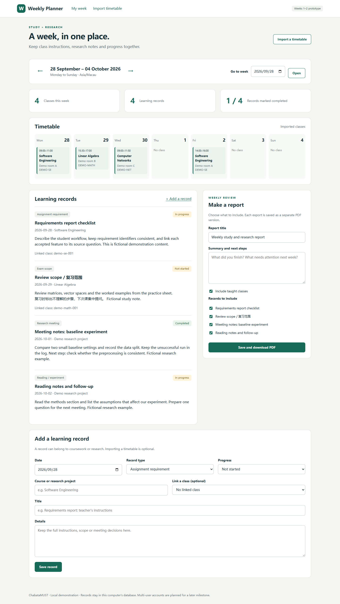

# Weekly Study and Research Planner

Software Engineering · Macau University of Science and Technology  
Team: ChabataMUST · ZhaoYue (赵玥) and WangYule (王宇乐)  
Milestone: Week 3 — account ownership, course/project records and data migration

Repository: https://github.com/ChabataMUST/Weekly-Study-and-Research-Planner-MUST

We want a place to keep the instructions that accumulate during a semester: an assignment requirement clarified in class, the chapters included in an exam, or the next experiment agreed at a research meeting. Our planner groups these records by week, keeps them beside the timetable and lets us select what goes into a weekly PDF. Students doing research can use the same workspace for their taught courses and research notes.

Weeks 1–2 connected timetable import, weekly records and PDF export in a working local application. Week 3 adds private accounts and turns the free-text course label into real course, project and academic-item records. Every class, note and report now belongs to one account, and ownership is checked on the query rather than hidden in the interface, so one student cannot read another's record even by requesting its identifier directly. The school timetable is still prepared as a CSV file, which the program validates and reconciles with saved classes. Screenshot recognition and direct school-account integration remain outside this build.



## Run the application

Install Python 3.11 or newer. On Windows, extract the project to a writable folder, double-click `setup.cmd` and wait for installation to finish. Then double-click `start.cmd`, leave its terminal open and visit **http://127.0.0.1:5000**. The first installation needs an internet connection to download dependencies.

For command-line setup, open CMD in the folder containing `run.py`:

```bat
python -m venv .venv
.venv\Scripts\python.exe -m pip install -r requirements.txt
.venv\Scripts\python.exe scripts\seed_demo.py
.venv\Scripts\python.exe run.py
```

The application now opens on a sign-in page. Create an account first; each account keeps its own classes, records and reports. The optional seed command creates a demonstration account named `demo` (password `demo-password`) with five fictional classes across two weeks and four learning records; it skips a database that already contains classes or notes. Without seeding, a freshly registered account starts empty. The week page defaults to the current week; use the week picker or `?week=2026-09-28` to reach the demonstration data. Stop the server with Ctrl+C.

If a database from the Weeks 1–2 single-profile build already exists in `instance/`, it is migrated automatically on the next start: a backup is written beside it, the old records move to a reserved account, and the first account you register adopts them.

The [Chinese running guide](docs/run-guide.zh-CN.md) explains file selection and common Windows errors. On macOS/Linux, use `.venv/bin/python` and forward slashes in script paths. This build runs locally on one computer. GitHub hosts its source; a running Python server is needed to use the application.

## Current functionality

| Area | Available in this build | How to inspect it |
| --- | --- | --- |
| Private accounts | Registration, sign-in and per-account ownership enforced on every query | Register two accounts and confirm each sees only its own records |
| Timetable import | UTF-8 CSV validation, added/updated/unchanged preview, confirmation and cancellation | Import the sample timetable, then reimport it |
| Safe reimport | Stable occurrence keys, preserved note links, whole-batch rollback, stale-preview rejection and a field-level change record | Use the update sample and inspect `event_changes` |
| Course and project records | Classes and notes belong to a course or a research project instead of free text | Add a record and choose or name its course/project |
| Weekly workspace | Dated classes, coursework and research records, optional class links and initial progress labels | Browse the demonstration weeks and add a record |
| Weekly PDF | Title, summary, selected records, optional timetable and embedded Chinese/English font | Export a report with one record excluded |
| Saved report versions | A snapshot and PDF are stored for each export | Reopen an earlier version after a later export |
| Local persistence | SQLite storage across restarts, with an automatic backup before migration | Restart the application and reopen the same week |

Requirement revision history, resource registration/search and full task workflows are planned for later milestones. `academic_items` is created now but populated from Week 4. Automatic scheduling and Word export are deferred. Progress labels currently describe saved records; they do not calculate workload or academic performance.

## Demonstrate the milestone

1. Start the application and create an account on the sign-in page. You are signed in automatically. (Or run `scripts\seed_demo.py` first and sign in as `demo` / `demo-password`.)
2. Import `samples/timetable-demo.csv`. The preview should show five added occurrences. Confirm the batch. Four classes belong to the week starting 28 September; the fifth appears in the following week.
3. Import the same file again. All five rows should be unchanged.
4. Import `samples/timetable-update.csv`. One room should change. Cancel the preview and check that the old room remains. Repeat the import and confirm it.
5. Add an assignment requirement dated within the displayed week, choosing or naming its course. Add a research meeting record under a project, without a class link. Both should appear in the weekly workspace.
6. In the report form, enter a title and summary, exclude one record and download the PDF. Check that the excluded record is absent and that Chinese text is readable.
7. Create a second report with a different summary, refresh the week page and reopen the first saved version. It should retain its original content.
8. Sign out, create a second account and try to open the first account's report by editing the id in the URL. It should return "not found", and the second account should show none of the first account's classes or records.

`samples/timetable-invalid.csv` supplies a rejected-input example. [The CSV specification](docs/import-format.md) explains field names, limits and reimport rules. [The sample PDF](docs/sample-weekly-report.pdf) shows the output without requiring installation.

## Design and validation

Flask handles the browser forms, SQLite stores the local data and ReportLab creates the PDFs. The [design notes](docs/design.md) contain the screen flow and data model. The [milestone record](docs/week-01-02.md) connects the first two weeks of work to the files in this release.

Install the development dependencies and run the tests from the project root:

```bat
.venv\Scripts\python.exe -m pip install -r requirements-dev.txt
.venv\Scripts\python.exe -m unittest discover -s tests -v
```

All 33 tests pass in the Week 3 check. They exercise import validation and transactions, persistence, week boundaries, form protection, escaped note content, PDF selection and saved versions, plus account ownership, cross-account isolation, password hashing and migration of a Week 1–2 database. [Validation details](docs/validation.md) and [the test log](docs/test-results.txt) accompany the release. These are development checks; customer acceptance of the finished system is a later activity.

To reproduce the example PDF, run `.venv\Scripts\python.exe scripts\make_sample_report.py`. The script uses a temporary database and writes `docs/sample-weekly-report.pdf`.

## Repository layout

```text
planner/       Application routes, database schema and migration, import, auth and PDF logic
  auth.py      Registration, sign-in and ownership enforcement
  db.py        Schema, versioned migration and connection handling
  templates/   Sign-in, register, weekly page, upload page, preview and error page
  static/      Stylesheet
  fonts/       PDF font and its redistribution license
samples/       CSV template and example inputs
scripts/       Installation, demo seeding and sample PDF generation
tests/         Automated milestone tests
docs/          Design, running guide, screenshots and validation evidence
reports/       Short milestone progress note
run.py         Local server entry point
```

The application creates its database and session key in `instance/`. Keep that folder, virtual environments and installer caches out of commits. Examples are labelled as fictional where appropriate. The small observed-source CSV contains one transcribed class, with teacher and room details omitted.

## Team and further work

ZhaoYue brings project organization, ideas and practical experimentation. WangYule brings programming experience, including C++ and Python, and technical problem solving. Both members take part in design, implementation, testing and documentation. The [collaboration guide](CONTRIBUTING.md) describes how we can review changes together without assigning all technical work to one person.

The next milestone adds requirement revision history and cross-week retrieval on top of the course/project records introduced in Week 3, followed by resource registration and retrieval. The [ten-week plan](docs/week-01-02.md) retains the later task, reporting and research work.

Runtime dependencies are Flask and ReportLab; pypdf is a test dependency. Noto Sans SC is distributed with its SIL Open Font License. See [third-party notices](THIRD_PARTY_NOTICES.md).
