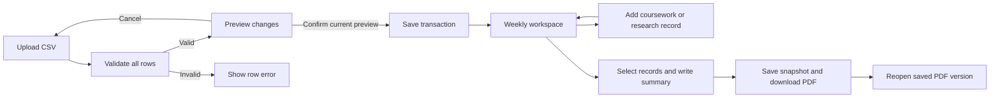
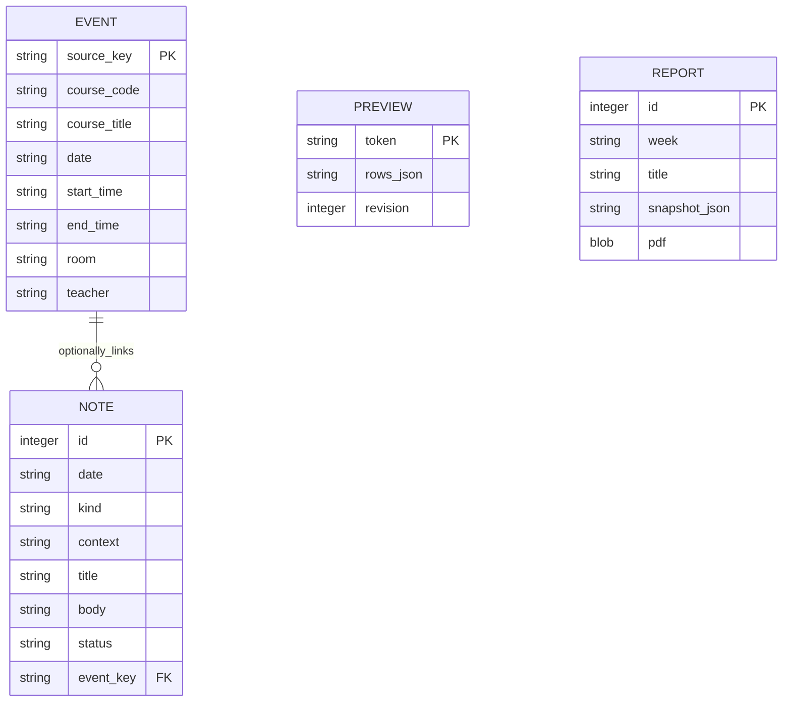

# Initial design and screen flow

## Why this prototype uses a small Python application

Our immediate uncertainty is whether the selected timetable input and PDF output can work together. Flask handles forms and pages, SQLite persists the small local data set, and ReportLab generates PDFs. There is no JavaScript build tool or external service account to configure. This keeps the Week 2 demonstration reproducible while leaving the course, task and account models for the next stage.

The first implementation is deliberately a single local profile. Private multi-user accounts in the Task 2 specification are still required for the final product. Form tokens and HTML escaping are already present, but they do not make this prototype a complete account-isolated service.

## Screen flow

The week view shows dated occurrences, saved learning records and a simple count of completion labels. A record can exist without a linked class so that a student with research work and no courses can use the same page. The count is not a weighted workload or academic performance score.

## Prototype data model

`event_key` is optional. Notes keep their own record date even when the linked class moves; moving a class does not rewrite the date on which a note was made. A report holds selected record values rather than live foreign-key views, so re-opening a stored PDF reproduces the earlier export.

The schema also stores an import-batch count and one timetable revision counter. All classes in a batch are saved in one transaction. Updates use SQL UPDATE rather than deletion/reinsertion to retain identity and note links. Preview tokens are single-use and checked against the current revision before saving.

## Representative examples

An assignment requirement is recorded on Monday. On Wednesday, the timetable is reimported with a new room. The note remains linked to the same occurrence; the importer only changes the class fields. A later teacher amendment will need a separate revision record in Week 4; the current prototype stores new notes without revision links.

A research student can save a meeting note on Thursday without importing any classes. The note appears in Thursday's week and can be included in the same PDF as coursework. A researcher who does have courses can import them through the normal CSV route.

A student prepares a weekly PDF, excludes an examination note, and downloads it. The selected data is copied into the snapshot before rendering. Excluded records are absent from both that snapshot and the PDF. Editing the report title or summary before the next export creates a different version.

## Separation from the final design

Course metadata is repeated on occurrences in this feasibility model, and academic context on notes is free text. Before adding full assignment history and resource retrieval, these should become separate course, academic-item and revision entities with account ownership. The current statuses are initial record labels; there is no task state machine, carry-forward history or dependency graph yet.

Remaining error-handling work includes persistent drafts after report-generation failures and in-page recovery of failed form submissions. In the current prototype, failed validation shows a message and the user returns to the form using the browser. Uploaded CSV data is never partially accepted.
