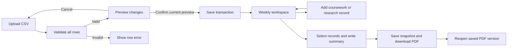
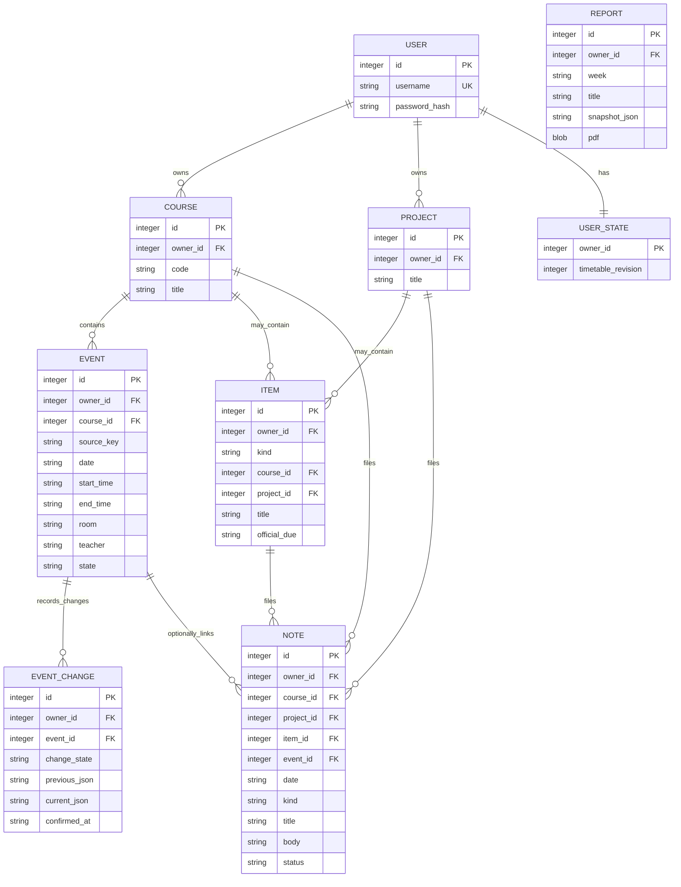

# Initial design and screen flow

## Why this application uses a small Python stack

The immediate uncertainty in Week 1 was whether the selected timetable input and PDF output could work together. Flask handles forms and pages, SQLite persists the local data set, and ReportLab generates PDFs. There is no JavaScript build tool or external service account to configure. This keeps each milestone reproducible while the record models grow.

Week 3 replaced the single local profile with account ownership. Every record now carries an `owner_id`, and each query filters by it, so one account cannot read another's records even by requesting an identifier directly (Task 2 REQ-1.1, NFR-S1). Form tokens and HTML escaping were present from Week 2; account isolation is what Week 3 adds on top of them.

## Screen flow

The week view shows dated occurrences, saved learning records and a simple count of completion labels. A record can exist without a linked class so that a student with research work and no courses can use the same page. The count is not a weighted workload or academic performance score.

## Data model (Week 3)

Account ownership came first because revisions and resource retrieval both need a
reliable parent record. A student owns courses and projects; classes, notes,
reports and previews all belong to the student through `owner_id`.

Three decisions are worth calling out because they are easy to undo by accident:

- **`events.source_key` is unique per owner, not globally.** The surrogate `id` is the occurrence's identity. Two accounts can each import `demo-se-001`; they are two rows. An update uses `UPDATE` on the `id`, so notes linked through `event_id` keep pointing at the same class (REQ-1.3).
- **`user_state.timetable_revision` is per account.** One student's import no longer invalidates another student's pending preview, and the stale-preview check still works within an account.
- **`event_changes` stores previous and current values with a confirmation time** (Task 2 6.2.8). A confirmed change is written here as part of the same transaction as the `events` update. The `state` column (`scheduled`/`cancelled`) is excluded from import comparison, so reimporting a file does not silently un-cancel a class.

A report holds selected record values rather than live foreign-key views, so re-opening a stored PDF reproduces the earlier export. `academic_items` is created in Week 3 but populated from Week 4, when requirement revisions need a stable parent to hang from.

## Representative examples

An assignment requirement is recorded on Monday. On Wednesday, the timetable is reimported with a new room. The note remains linked to the same occurrence; the importer only changes the class fields. A later teacher amendment will need a separate revision record in Week 4; the current prototype stores new notes without revision links.

A research student can save a meeting note on Thursday without importing any classes. The note appears in Thursday's week and can be included in the same PDF as coursework. A researcher who does have courses can import them through the normal CSV route.

A student prepares a weekly PDF, excludes an examination note, and downloads it. The selected data is copied into the snapshot before rendering. Excluded records are absent from both that snapshot and the PDF. Editing the report title or summary before the next export creates a different version.

## Separation from the final design

Course metadata is repeated on occurrences in this feasibility model, and academic context on notes is free text. Before adding full assignment history and resource retrieval, these should become separate course, academic-item and revision entities with account ownership. The current statuses are initial record labels; there is no task state machine, carry-forward history or dependency graph yet.

Remaining error-handling work includes persistent drafts after report-generation failures and in-page recovery of failed form submissions. In the current prototype, failed validation shows a message and the user returns to the form using the browser. Uploaded CSV data is never partially accepted.
